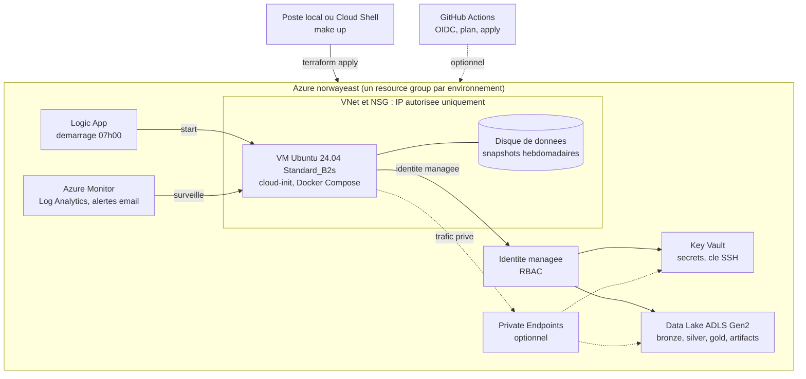
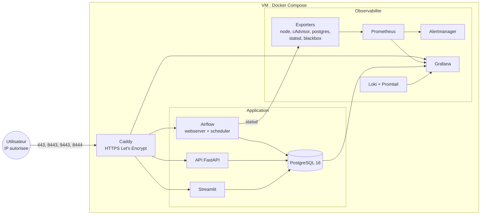
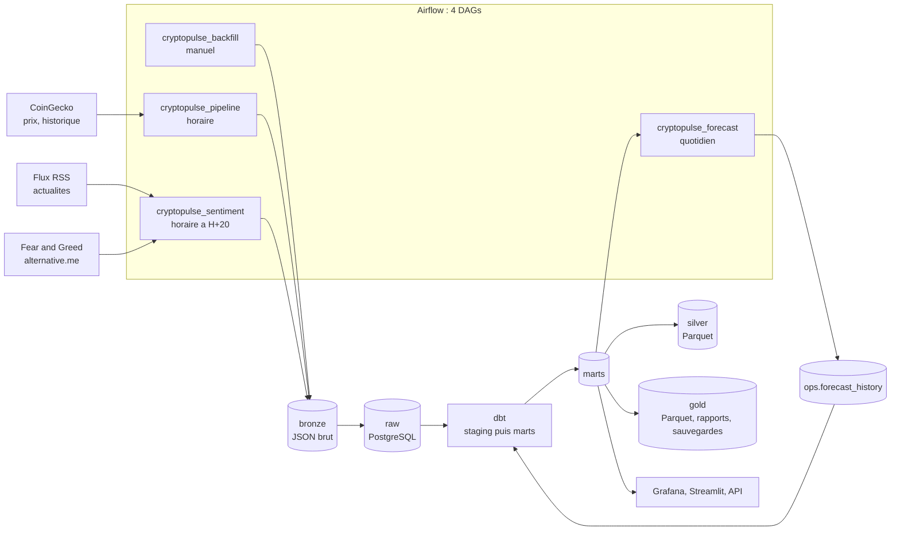
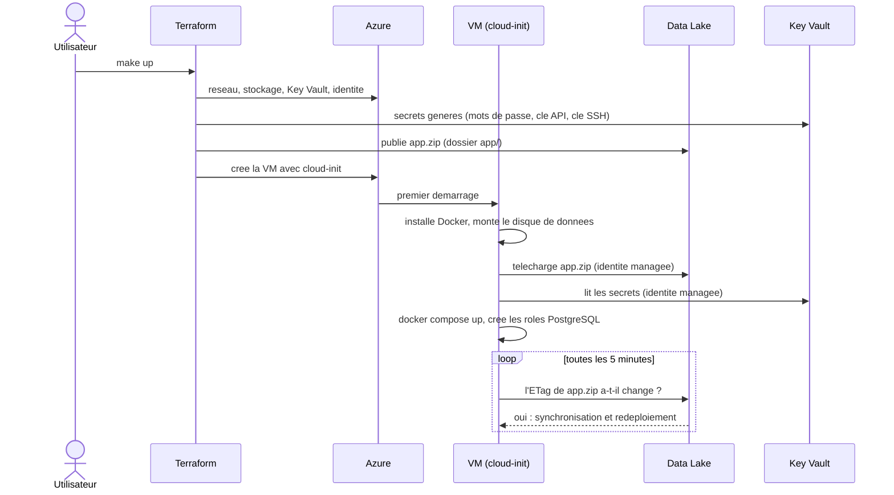

# Architecture de CryptoPulse

Ce document complète le README avec des diagrammes. Les décisions qui les justifient sont dans [docs/adr](adr/README.md).

## Vue d'ensemble de l'infrastructure

## Services sur la VM

## Flux de données

## Déploiement : de `make up` à la plateforme en service

## Planning des traitements (UTC)

| Heure | Traitement |
|---|---|
| Chaque heure, minute 00 | `cryptopulse_pipeline` : ingestion, validation, chargement, dbt, export Parquet, qualité |
| Chaque heure, minute 20 | `cryptopulse_sentiment` : actualités, Fear and Greed, modèles dbt de sentiment |
| 02h30 | `cryptopulse_forecast` : prévisions à 7 jours, précision des prévisions passées |
| 03h30 | Sauvegarde PostgreSQL vers `gold/backups/` ; snapshot du disque si le dernier a plus de 6 jours |
| 07h00 (dev) | Démarrage automatique de la VM par la Logic App |
| 21h00 (dev) | Extinction automatique de la VM |
| Toutes les 5 minutes | Synchronisation de l'artefact de déploiement |
